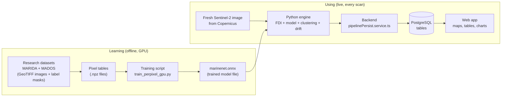
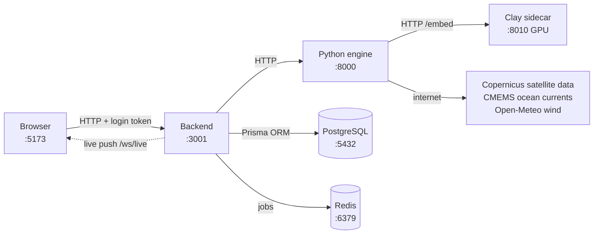
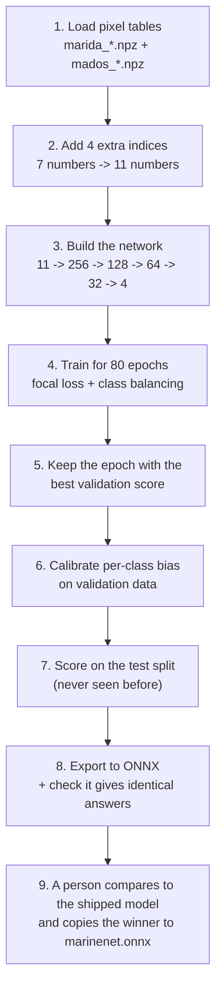
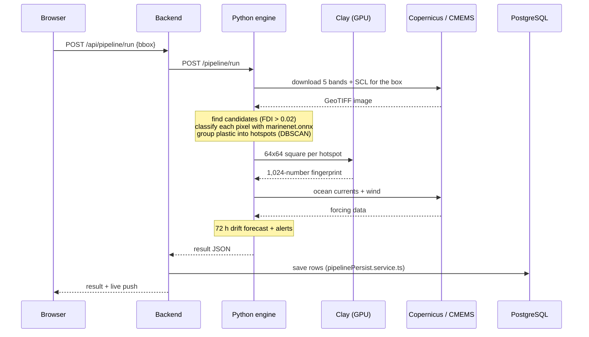
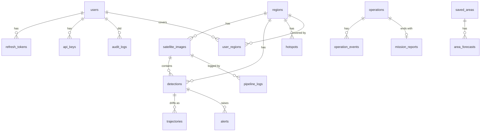
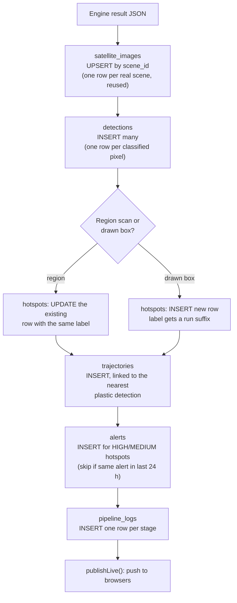

# Data, Database and Model Guide — Marine Plastic Tracker

*A plain-language guide to every piece of data in the project: where it comes from, what format it is in, how the model learns from it, where it is stored, and how to look at it.*

*As of 2026-10-03.*

---

## Contents

1. [The big picture in one minute](#1-the-big-picture-in-one-minute)
2. [Architecture: the six running parts](#2-architecture-the-six-running-parts)
3. [Data architecture: the four kinds of data](#3-data-architecture-the-four-kinds-of-data)
4. [Training data: which datasets, what format, where on disk](#4-training-data-which-datasets-what-format-where-on-disk)
5. [How the model is trained, step by step](#5-how-the-model-is-trained-step-by-step)
6. [The model files](#6-the-model-files)
7. [Live data: what happens during a scan](#7-live-data-what-happens-during-a-scan)
8. [Images: every image format in the project](#8-images-every-image-format-in-the-project)
9. [The database: tables, and which file defines them](#9-the-database-tables-and-which-file-defines-them)
10. [How to see the tables](#10-how-to-see-the-tables)
11. [When a new record comes in: which file writes it](#11-when-a-new-record-comes-in-which-file-writes-it)
12. [How to add a new field or table](#12-how-to-add-a-new-field-or-table)
13. [Every storage location in one table](#13-every-storage-location-in-one-table)
14. [Quick glossary](#14-quick-glossary)

---

## 1. The big picture in one minute

The project uses data in two separate ways:

1. **Learning (offline, done once):** labelled satellite images from public research datasets teach a small neural network to tell **Plastic**, **Algae**, **Sea foam** and **Water** apart. The trained network is saved as a file (`marinenet.onnx`).
2. **Using (live, every scan):** when a user draws a box on the map, the system downloads a fresh Sentinel-2 satellite image, runs that saved network on every suspicious pixel, groups the plastic pixels into hotspots, predicts where they will drift, and **saves the results as rows in a PostgreSQL database**.



Key idea: **the model never learns from live scans.** Live scans only *use* the model. Training only happens when someone runs the training script by hand.

---

## 2. Architecture: the six running parts

| Part | Port | Language | Job | Folder |
| --- | --- | --- | --- | --- |
| Frontend | 5173 | React + TypeScript | The website people click on | `frontend/` |
| Backend | 3001 | Node.js + TypeScript | Login, permissions, **saving to the database**, exports | `backend/` |
| Python engine | 8000 | Python (FastAPI) | All the science: download images, run model, drift | `python_engine/` |
| Clay sidecar | 8010 | Python + PyTorch (GPU) | A second, bigger AI model that double-checks plastic | `python_engine/clay_service.py` |
| PostgreSQL | 5432 | Database | Stores every result permanently | data in `infra/` |
| Redis | 6379 | Queue | Holds background jobs (optional) | `infra/` |



**Important rule:** only the **backend** writes to the database. The Python engine does the science and returns JSON; the backend turns that JSON into database rows.

---

## 3. Data architecture: the four kinds of data

| Kind | Example | Format | Where it lives | Changes how often |
| --- | --- | --- | --- | --- |
| **Raw training data** | MARIDA, MADOS images and labels | GeoTIFF (`.tif`), text split lists, shapefiles | `data/` | Never (downloaded once) |
| **Prepared training data** | Labelled pixels as number tables | NumPy `.npz` | `python_engine/models/` | When you rebuild the cache |
| **Trained models + settings** | The neural network, thresholds, scores | `.onnx`, `.pt`, `.json`, `.npz` | `python_engine/models/` | When you retrain |
| **Live app data** | Detections, hotspots, alerts, users | Database rows | PostgreSQL (`marine_plastic` database) | Every scan |

There is also a **fifth, optional copy**: a MySQL "dataset browser" (`database/mysql/`) that copies the training datasets and a snapshot of the app tables into MySQL, just so you can browse them in MySQL Workbench. The app never reads from it.

---

## 4. Training data: which datasets, what format, where on disk

### 4.1 The datasets

| Dataset | What it is | Used for | Size on disk | Folder | Adapter (reader) |
| --- | --- | --- | --- | --- | --- |
| **MARIDA** (Kikaki et al. 2022) | Hand-labelled Sentinel-2 patches of marine debris, algae, foam, water | **Training** (main) | ~4.5 GB | `data/marida/` | `python_engine/ml/datasets/marida.py` |
| **MADOS** (Kikaki et al. 2024) | Follow-up dataset, 174 scenes, same 15 classes | **Training** (main) | ~5.6 GB | `data/MADOS/` | `python_engine/ml/datasets/mados.py` |
| **RefinedFloatingObjects** (Russwurm et al. 2023) | 6 full scenes (Accra, Durban, Lagos, Marmara, New Orleans, Venice) with labelled points | Extra variety / testing | ~12 GB of imagery (~23 GB folder incl. zip) | `data/refinedfloatingobjects/` | `python_engine/ml/datasets/rfo.py` |
| **Plastic Litter Project** (PLP 2021/22) | Real plastic targets floated in the sea at known places and dates | **Real-world validation** | ~79 MB | `data/plp/` | `python_engine/ml/datasets/plp.py` |
| Country polygons | World coastlines | Land / sea check for drift | small | `data/coastline/countries.geojson` | `trajectory/coastline_loader.py` |

All of the above are **Sentinel-2** satellite data, which is why they can be mixed: the same bands mean the same thing in every dataset.

### 4.2 What the raw files look like

**MARIDA** (`data/marida/`):

```text
data/marida/
├── patches/
│   └── S2_1-12-19_48MYU/                 one folder per satellite tile + date
│       ├── S2_1-12-19_48MYU_0.tif        the image: 11 bands, 256 x 256 pixels
│       ├── S2_1-12-19_48MYU_0_cl.tif     the label mask: one class number (1-15) per pixel
│       └── S2_1-12-19_48MYU_0_conf.tif   how confident the human labeller was
├── splits/
│   ├── train_X.txt                       list of patch names for training
│   ├── val_X.txt                         ... for validation (choosing the best epoch)
│   └── test_X.txt                        ... for the final honest score
├── shapefiles/                           the original hand-drawn label polygons
└── labels_mapping.txt                    class number -> class name
```

- The image `.tif` has **11 bands** in this order: B01, B02, B03, B04, B05, B06, B07, B08, B8A, B11, B12.
- Values are **surface reflectance** (roughly 0 to 1: how much sunlight the surface reflects in that colour).
- The `_cl.tif` mask has the same width and height; each pixel holds a class number, 0 = unlabelled.

**MADOS** (`data/MADOS/`):

```text
data/MADOS/
├── Scene_0/
│   ├── 10/   10 m bands (Scene_0_L2R_rhorc_<wavelength>_<crop>.tif)
│   │         + label masks Scene_0_L2R_cl_<crop>.tif, confidence _conf_, quick-look _rgb_ .png
│   ├── 20/   20 m bands (e.g. Scene_0_L2R_rhorc_1610_1.tif = band B11, crop 1)
│   └── 60/   60 m bands
├── Scene_1/ ...
└── splits/   train_X.txt, val_X.txt, test_X.txt
```

- One `.tif` **per band**, named by wavelength. The reader sorts them so the order matches MARIDA, and stretches the 20 m and 60 m bands onto the 10 m grid.

### 4.3 From 15 classes to 4

The research datasets have 15 detailed classes. The app only needs 4, so each reader maps them:

| App class (number) | Comes from (MARIDA / MADOS names) |
| --- | --- |
| **Plastic (0)** | Marine Debris |
| **Algae (1)** | Dense Sargassum, Sparse Floating Algae, Natural Organic Material |
| **Sea_Foam (2)** | Foam |
| **Water (3)** | Marine Water, Sediment-Laden Water, Turbid Water, Shallow Water (and other water backgrounds) |
| *dropped* | Ships, Clouds, Cloud Shadows, Waves, Wakes, Oil Spills, Oil Platforms, Jellyfish, Sea Snot |

Muddy and turbid water are deliberately labelled **Water**, so the model learns that bright coastal water is not debris.

The exact maps are the `CLASS_MAP` dictionaries at the top of `marida.py` and `mados.py`.

### 4.4 From images to a table of pixels

The model does not look at whole pictures. It looks at **one pixel at a time**. So each reader turns every labelled pixel into one row of numbers:

```text
one pixel  ->  [B04, B06, B08, B8A, B11, FDI, NDVI]   label
               red  red-  near near SWIR  debris veg.
                    edge  IR   IR         index  index
example    ->  [0.031, 0.042, 0.061, 0.058, 0.021, 0.018, 0.33]   -> 0 (Plastic)
```

- **B04, B06, B08, B8A, B11** are 5 Sentinel-2 colour bands (red, red-edge, two near-infrared, short-wave infrared).
- **FDI** (Floating Debris Index) measures how much brighter a pixel is in near-infrared than expected for water. Floating stuff sticks out.
- **NDVI** measures "greenness"; it helps separate algae (alive, green) from plastic.

These rows are saved as compressed NumPy files so the slow image reading is done only once:

| File | Contents |
| --- | --- |
| `python_engine/models/marida_train.npz`, `marida_val.npz`, `marida_test.npz` | `x` = table of shape (number of pixels, 7), `y` = labels (0–3) |
| `python_engine/models/mados_train.npz`, `mados_val.npz`, `mados_test.npz` | same, for MADOS |
| `rfo_pixels_*.npz`, `plp_pixels_*.npz` | same 7-number rows for the extra datasets |
| `rfo_chips_*.npz`, `patches_*.npz` | small 64 x 64 image squares (for Clay and the patch-CNN experiment) |

The shipped model was trained on **1,081,615 pixels** and tested on **499,907 pixels** that it never saw during training. About 98 % of all pixels are Water, which is why the classes need balancing (next section).

---

## 5. How the model is trained, step by step

Training runs on the laptop GPU (RTX 4050) inside the conda environment `mpt-train`:

```powershell
cd python_engine
conda run -n mpt-train python -m ml.train_perpixel_gpu --epochs 80 --loss focal --weights cb --hidden 256,128,64,32 --calibrate
```

What happens inside `python_engine/ml/train_perpixel_gpu.py`:



1. **Load** the `.npz` pixel tables for train, validation and test.
2. **Add 4 engineered features** to each row (function `augment11`): Plastic Index (PI), a water index (MNDWI), red-edge NDVI and overall brightness. They are calculated from the same 5 bands, so they cost no extra download. Each pixel is now **11 numbers**.
3. **Build** a small fully-connected network (an MLP): 11 inputs → layers of 256, 128, 64, 32 → 4 outputs (one score per class).
4. **Train** with the AdamW optimiser, cosine learning-rate schedule, batches of 8,192 pixels.
    - **Focal loss** makes the model focus on hard, rare pixels instead of easy water.
    - **Class-balanced weights** stop Water (98 % of the data) from drowning out Plastic.
5. **Pick the best epoch** by validation macro-F1 (the average score over the 4 classes).
6. **Calibrate:** nudge each class's output bias so precision and recall balance well on the validation set. The nudge is baked into the exported file.
7. **Test** once on the held-out test split.
8. **Export** to ONNX, a portable model format that runs without PyTorch, and check that the ONNX file gives the same answers as the PyTorch model.
9. **Nothing is replaced automatically.** The script writes candidate files (e.g. `marinenet_pp11.onnx`) and prints a verdict. A person copies the winner over `marinenet.onnx` and keeps the old one as a backup (`marinenet_prev.onnx`, `marinenet_pre_<date>.onnx`).

The shipped model is an **ensemble**: the same recipe trained 3 times with different random seeds, with their outputs averaged. Its test results (from `python_engine/models/metrics.json`):

| Class | Precision | Recall | F1 |
| --- | --- | --- | --- |
| Plastic | 0.776 | 0.824 | 0.799 |
| Algae | 0.648 | 0.822 | 0.725 |
| Sea_Foam | 0.681 | 0.835 | 0.750 |
| Water | 0.998 | 0.993 | 0.995 |
| **Macro-F1 (headline)** | | | **0.8175** |

Overall accuracy is 0.99, but that number is inflated because almost everything is Water. **Macro-F1 is the honest number to quote.**

### The second model: Clay

**Clay v1.5** is a large pre-trained Earth-observation model (about 4.8 GB). It is **not trained from scratch** here. It turns a 64 x 64 image square into a list of 1,024 numbers (an "embedding" or fingerprint). The project then:

- builds a reference library of fingerprints from labelled squares (`clay_emb_*.npz`, `clay_index.npz`);
- trains a small head on top (`ml/train_clay_head.py` → `clay_head.pt`);
- tunes how to combine Clay with the MLP (`ml/tune_fusion.py` → `fusion_thresholds.json`).

Result: at the **CONFIRMED** level, plastic precision rises from 0.78 to about 0.92.

### Checking against reality

- `ml/validate_plp.py` and `ml/validate_plp_clay.py`: does the model find the real floated plastic targets? Results in `plp_validation.json` and `plp_clay_validation.json`. This is the weakest result, because the targets are smaller than one pixel.
- `ml/validate_drift.py`: scores drift predictions against reference tracks.
- `docs/code-tour/live_training_demo.py`: a short demo that trains a model live in about 20 seconds without touching the shipped one.

---

## 6. The model files

All in `python_engine/models/`:

| File | What it is | Used live? |
| --- | --- | --- |
| `marinenet.onnx` | **The live classifier** (3-seed MLP ensemble, 11 inputs, 4 outputs) | Yes |
| `marinenet_prev.onnx`, `marinenet_pre_*.onnx` | Backups of earlier versions | No |
| `marinenet_pp7*.onnx`, `marinenet_pp11*.onnx`, `marinenet_ens.onnx` | Training candidates | No |
| `marinenet_patch.onnx` | Patch CNN experiment; scored worse and was not shipped | No |
| `metrics.json` | Official test scores shown in the app's AI Lab | Yes (read) |
| `perpixel_gpu_summary*.json` | Full training reports | No |
| `clay_head.pt`, `clay_threshold.json`, `clay_index.npz` | Clay verifier pieces | Yes |
| `fusion_thresholds.json` | How MLP + Clay are combined; re-read live | Yes |
| `hotspot_embeddings.npz` | Fingerprints of real hotspots found by scans, by date | Yes |
| `embed_queue/` | Hotspot squares waiting to be fingerprinted | Yes |
| `*_train.npz`, `*_val.npz`, `*_test.npz` | Prepared training data (Section 4.4) | No |

The engine loads the model in `python_engine/ml/model_loader.py`, using the GPU if available, otherwise the CPU.

---

## 7. Live data: what happens during a scan



Step by step, with the data format at each step:

| # | Step | File | Data in → data out |
| --- | --- | --- | --- |
| 1 | User draws a box | `frontend/src/pages/MapExplorer.tsx` | mouse drag → `{north, south, east, west}` |
| 2 | Backend checks login, forwards | `backend/src/routes/pipeline.routes.ts` | JSON request → HTTP call to engine |
| 3 | Download image | `python_engine/satellite/download.py`, `band_loader.py` | box → GeoTIFF with 6 channels: B04, B06, B08, B8A, B11, SCL (float32) |
| 4 | Cloud and land check | `satellite/cloud_masker.py` | SCL channel → % water/land/cloud + reliability grade |
| 5 | Find candidates | `satellite/fdi_calculator.py`, `threshold_applier.py` | image → list of pixels with FDI > 0.02 over water (max 500) |
| 6 | Classify | `ml/batch_classifier.py` → `ml/inference_engine.py` | 11 numbers per pixel → class + confidence (0–1); HIGH tier when plastic ≥ 0.648 |
| 7 | Group into hotspots | `hotspot/dbscan_clusterer.py`, `severity_scorer.py` | HIGH plastic points → clusters with severity HIGH (≥10) / MEDIUM (≥5) / LOW (≥3) |
| 8 | Double-check with Clay | `ml/clay_live.py`, `ml/confidence_fusion.py` | 64x64x5 square → CONFIRMED / POSSIBLE |
| 9 | Drift forecast | `trajectory/forecast.py`, `lagrangian_model.py` | currents + wind → 72 h path + uncertainty cone + landfall chance |
| 10 | Alerts | `hotspot/alert_trigger.py` | HIGH/MEDIUM hotspots → alert objects |
| 11 | Return JSON | `python_engine/schemas.py` (defines the shape) | everything above → one JSON object |
| 12 | **Save to database** | `backend/src/services/pipelinePersist.service.ts` | JSON → rows in 6 tables (Section 11) |
| 13 | Update screen | `frontend/src/hooks/useLiveFeed.ts` | live push → tables and map refresh |

---

## 8. Images: every image format in the project

| Image | Format | Bands / shape | Where | Kept? |
| --- | --- | --- | --- | --- |
| MARIDA patch | GeoTIFF | 11 bands, 256 x 256 | `data/marida/patches/` | Yes, on disk |
| MARIDA label mask | GeoTIFF | 1 band, class numbers | `..._cl.tif` | Yes |
| MADOS scene | GeoTIFF, one file per band | 10 / 20 / 60 m folders | `data/MADOS/Scene_*/` | Yes |
| RFO scene | GeoTIFF, 12–13 bands | full Sentinel-2 tiles | `data/refinedfloatingobjects/` | Yes |
| **Live scan image** | GeoTIFF from Sentinel Hub, read with `tifffile` | 6 channels: B04, B06, B08, B8A, B11, SCL | memory only | **No** — only the results are saved |
| Clay / patch squares | NumPy arrays | 64 x 64 x 6 (float16) | `.npz` in `python_engine/models/` | Yes |
| Exported index map | GeoTIFF | 1 band (e.g. FDI) | downloaded by user via `/export/geotiff` | User's choice |
| Scene thumbnail | URL | — | `satellite_images.bands_meta.thumbnail` | Link only |

Why live images are not saved: a scan only needs the pixels for a few seconds. Storing every downloaded image would fill the disk quickly, so the database keeps the scene's ID, date, cloud cover and box (`satellite_images` table) instead.

Raw images are never put inside a database table. Images stay as files; tables only point to them.

---

## 9. The database: tables, and which file defines them

### 9.1 Where the tables are defined

**All app tables are defined in one file: [`backend/prisma/schema.prisma`](../backend/prisma/schema.prisma).**

Each `model` block in that file becomes one PostgreSQL table. The `@@map("...")` line gives the real table name:

```prisma
model Detection {            // name used in TypeScript code: prisma.detection
  id             String @id @default(cuid())
  lat            Float
  lon            Float
  classification String     // Plastic | Algae | Sea_Foam | Water
  confidence     Float      // 0.0 – 1.0
  ...
  @@map("detections")        // real table name in PostgreSQL
}
```

Other database files:

| File | Purpose |
| --- | --- |
| `backend/prisma/schema.prisma` | **The source of truth for every app table** |
| `backend/prisma/seed.ts` | Fills an empty database with regions, demo users and sample rows (`npm run db:seed`) |
| `backend/src/lib/prisma.ts` | Opens the database connection |
| `backend/src/data/repo.ts`, `areas.repo.ts`, `operations.repo.ts`, `users.ts` | Read/write functions used by the routes |
| `backend/src/data/mock.ts` | Fake in-memory data used when PostgreSQL is offline |
| `infra/postgres/init.sql` | First-time PostgreSQL setup |
| `database/mysql/*.sql` | Optional MySQL copy for browsing (Section 10.4) |

Database name: **`marine_plastic`** on `localhost:5432` (connection string `DATABASE_URL` in `.env`).

### 9.2 The 18 tables

| Group | Table (real name) | One row means | Key columns |
| --- | --- | --- | --- |
| **Science** | `regions` | A monitored coastal region (MUM, GOA, KCH, CHN, AND) | code, name, center_lat/lon, bounding_box |
| | `satellite_images` | One satellite scene used by a scan | scene_id, tile, acquisition_date, cloud_cover_pct, bands_meta |
| | `detections` | **One classified pixel** | lat, lon, classification, confidence, fdi_score, area_sq_km, status |
| | `hotspots` | A cluster of plastic detections | label, centroid_lat/lon, detection_count, severity, eta_hours |
| | `trajectories` | A 72 h drift forecast | path_data (JSON points + cone), windage_coeffs, data_source |
| | `alerts` | A warning about a hotspot | type, severity, title, message, is_acked |
| | `pipeline_logs` | One stage of one scan (timing, status) | stage, status, duration_ms, error_msg |
| | `model_versions` | A record of a trained model | name, version, architecture, f1_score, precision, recall |
| **Users** | `users` | A person who can log in | username, email, password_hash, role, totp |
| | `user_regions` | Which user covers which region | user_id, region_id |
| | `refresh_tokens` | A login session | token, expires_at, revoked_at |
| | `api_keys` | A machine access key | key_hash, label, user_id |
| | `audit_logs` | Who did what, when (append-only) | action, resource, ip_address, metadata |
| **Field operations** | `operations` | A clean-up mission | code, status, priority, hotspot_id, target_lat/lon, assigned_team |
| | `operation_events` | A status change in a mission | operation_id, event |
| | `mission_reports` | The final report of a mission | outcome, plastic_collected_kg, area_cleared_sq_km, team_size |
| **Saved areas** | `saved_areas` | A box the user saved, with its latest scan | north/south/east/west, counts, result (JSON) |
| | `area_forecasts` | A drift forecast for a saved area (never overwritten) | origin_lat/lon, landfall_probability, eta_hours |

### 9.3 How the tables connect



`operations.hotspot_id` is plain text, not a hard link, because hotspots are recalculated on every scan and a hard link would delete missions along with old hotspots.

### 9.4 Formats inside the tables

- IDs are `cuid` strings (e.g. `clx9a8b...`), not numbers.
- Coordinates are plain decimal `lat` / `lon` (degrees).
- Flexible data is stored as **JSON** columns: `bands_meta`, `raw_band_values`, `path_data`, `saved_areas.result`.
- Fixed choices are **enums**: `RoleName` (ADMIN, COASTGUARD, FIELD), `DetectionStatus` (PENDING, CONFIRMED, FALSE_ALARM), `SeverityLevel`, `AlertType`, `PipelineStage`, `OperationStatus`.
- Times are stored as timestamps; `created_at` / `updated_at` are filled automatically.

---

## 10. How to see the tables

### 10.1 Prisma Studio (easiest)

```powershell
cd backend
npm run db:studio
```

A browser tab opens at http://localhost:5555 listing every table. Click a table to see, filter and edit rows.

### 10.2 psql (command line)

```powershell
psql "postgresql://mpt_user:<password>@localhost:5432/marine_plastic"
```

```sql
\dt                                   -- list all tables
\d detections                         -- show the columns of one table
SELECT classification, COUNT(*) FROM detections GROUP BY classification;
SELECT label, severity, detection_count FROM hotspots WHERE is_active ORDER BY created_at DESC LIMIT 10;
```

The password is in the repo-root `.env` (`DATABASE_URL`).

### 10.3 pgAdmin / DBeaver / VS Code

Use the same connection details: host `localhost`, port `5432`, database `marine_plastic`, user and password from `.env`.

### 10.4 MySQL dataset browser (training data as tables)

To browse the **training datasets** as tables (normally they are only files):

```powershell
cd database\mysql
pip install -r requirements.txt
python load_datasets.py      # builds mpt_datasets  (~5-10 min)
python sync_app.py           # copies the app tables into mpt_app (~1 min)
python build_dashboard.py    # writes dashboard.html with charts
```

Then open MySQL Workbench → **Schemas** → `mpt_datasets` → **Tables / Views**. Good starting views are `v_dataset_overview`, `v_class_balance`, `v_spectral_signature` and `v_model_comparison`. Full instructions are in [`database/mysql/README.md`](../database/mysql/README.md).

### 10.5 Check the database is reachable

```powershell
cd backend
npm run db:check
```

---

## 11. When a new record comes in: which file writes it

Every new record has exactly one file responsible for writing it:

| New thing | Triggered by | File that writes it | Table(s) |
| --- | --- | --- | --- |
| **Scan result** | `POST /api/pipeline/run` | `backend/src/services/pipelinePersist.service.ts` → `persistRun()` | `satellite_images`, `detections`, `hotspots`, `trajectories`, `alerts`, `pipeline_logs` |
| Background / scheduled scan | Redis job or `/api/pipeline/scheduled-run` | `backend/src/lib/queue.ts` → same `persistRun()` | same as above |
| New user | `POST /api/auth/register` | `backend/src/services/auth.service.ts` | `users` |
| Alert acknowledged | `PATCH /api/alerts/:id/ack` | `backend/src/routes/alerts.routes.ts` → `data/repo.ts` | `alerts` |
| Saved area | `POST /api/areas` | `backend/src/routes/areas.routes.ts` → `data/areas.repo.ts` | `saved_areas` |
| Area drift forecast | `POST /api/areas/:id/forecast` | `areas.routes.ts` → `areas.repo.ts` | `area_forecasts` |
| Field mission | `POST /api/operations` | `operations.routes.ts` → `data/operations.repo.ts` | `operations`, `operation_events`, `mission_reports` |

### What `persistRun()` does with one scan



Rules built into this file:

- If the database is down, the scan still works; the result is shown but not saved.
- The same satellite scene is stored once, even if scanned many times.
- Region hotspots are updated in place, so "MUM-H1" stays one row over time.
- Duplicate alerts within 24 hours are skipped.

---

## 12. How to add a new field or table

Example: you want to save a new number, `cloudScore`, for every detection.

1. **Engine sends it.** In `python_engine/schemas.py`, add the field to the detection schema, and fill it where detections are made (`ml/batch_classifier.py`).
2. **Database stores it.** In `backend/prisma/schema.prisma`, add to `model Detection`:

    ```prisma
    cloudScore Float? @map("cloud_score")
    ```

3. **Apply the change** to the real database:

    ```powershell
    cd backend
    npm run db:push        # quick: update tables to match the schema
    # or: npm run db:migrate   (creates a migration file you can commit)
    npm run db:generate    # refresh the TypeScript client
    ```

4. **Write it.** In `backend/src/services/pipelinePersist.service.ts`, inside `prisma.detection.createMany`, add `cloudScore: d.cloudScore`. Also add it to the `EngineResult` type at the top of that file.
5. **Read it.** If a page should show it, return it from `backend/src/data/repo.ts`, add it to `frontend/src/types/index.ts`, and display it in the page.
6. **Offline mode.** Add a sample value to `backend/src/data/mock.ts` so the app still works without a database.
7. **Check it** in Prisma Studio (`npm run db:studio`) after running a scan.

For a **new table**: add a new `model` block to `schema.prisma`, run steps 3–7, and add read/write functions in a new or existing file under `backend/src/data/`.

---

## 13. Every storage location in one table

| What | Where | Format | Size | In git? |
| --- | --- | --- | --- | --- |
| Raw training images | `data/marida`, `data/MADOS`, `data/refinedfloatingobjects`, `data/plp` | GeoTIFF, shapefile, text | ~37 GB incl. zips | No |
| Coastline | `data/coastline/countries.geojson` | GeoJSON | small | No |
| Prepared pixel tables | `python_engine/models/*_train/val/test.npz` | NumPy compressed | MB–GB | No |
| Live model + settings | `python_engine/models/marinenet.onnx`, `*.json` | ONNX, JSON | small | Yes |
| Clay model weights | `python_engine/models/clay/` | PyTorch | ~4.8 GB | No |
| Clay fingerprints | `python_engine/models/*.npz`, `embed_queue/` | NumPy | MB | No |
| **App records** | PostgreSQL `marine_plastic` | tables | grows with scans | No (data) / Yes (schema) |
| Table definitions | `backend/prisma/schema.prisma` | Prisma | — | Yes |
| Background jobs | Redis | key-value | small | No |
| Engine short-term cache | memory (`python_engine/cache.py`) | Python objects | — | No |
| Browser login + settings | browser localStorage | JSON | tiny | No |
| MySQL browsing copy | MySQL `mpt_datasets`, `mpt_app` | tables | GB | Scripts only |
| Settings and passwords | `.env` (repo root) | text | — | **No** (only `.env.example`) |

---

## 14. Quick glossary

| Word | Simple meaning |
| --- | --- |
| Sentinel-2 | A pair of European satellites that photograph the Earth in 13 colours (bands) every ~5 days |
| Band | One colour channel, e.g. B04 = red, B08 = near-infrared |
| Reflectance | How much light a surface reflects in a band (0 = none, 1 = all) |
| GeoTIFF | An image file that also stores where on Earth each pixel is |
| SCL | A ready-made Sentinel-2 layer that labels each pixel as water, land, cloud, etc. |
| FDI | Floating Debris Index: high when something floats on water |
| NDVI | Greenness index: high for living plants and algae |
| Pixel | One square of the image: 10 m x 10 m on the ground |
| MLP | A simple neural network made of stacked layers of numbers |
| Epoch | One full pass through all training data |
| Train / validation / test split | Data to learn from / to pick the best version / to give the final fair score |
| Precision | Of everything the model called plastic, how much really was |
| Recall | Of all the real plastic, how much the model found |
| F1 / Macro-F1 | A balance of precision and recall / its average over all 4 classes |
| ONNX | A model file format that runs anywhere, without PyTorch |
| Embedding | A list of numbers that summarises an image, used to compare images |
| DBSCAN | A method that groups nearby points into clusters |
| Prisma | The tool the backend uses to talk to PostgreSQL |
| `.npz` | A compressed file holding NumPy arrays |
| JSON | Text format for structured data, e.g. `{"lat": 19.0, "lon": 72.8}` |
