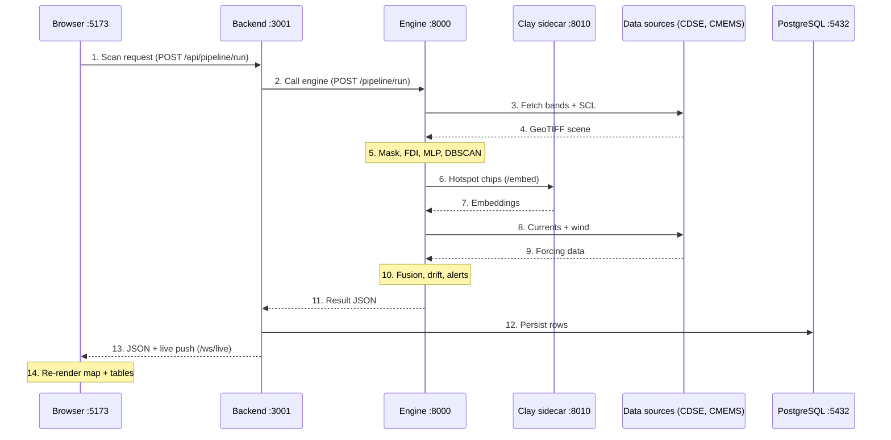

# Marine Plastic Tracker — Project Structure & Data/Control Flow

*As of 2026-10-02 · Darshan Gadekar*

## Overview

Marine Plastic Tracker turns free Sentinel-2 imagery into floating-plastic detections, hotspots and 72-hour drift forecasts, served through a role-based analyst console. It runs as six local processes: a React UI, a Node API, a Python science engine, a GPU sidecar for the Clay foundation model, PostgreSQL and Redis.

| Process | Port | Stack | Owns |
| --- | --- | --- | --- |
| Frontend | 5173 | React 18, Vite, TypeScript, Tailwind, Leaflet, React Query, Zustand | Analyst console, maps, charts |
| Backend | 3001 | Node 20, Express, TypeScript, Prisma, BullMQ, ws | Auth + RBAC, persistence, job queue, exports, WebSocket push |
| Python engine | 8000 | Python, FastAPI, numpy, onnxruntime (no torch) | All the science: ingest, FDI, MLP classifier, DBSCAN, drift |
| Clay sidecar | 8010 | Python, PyTorch (conda env `mpt-train`), GPU | 1024-d Clay v1.5 embeddings for the second-stage verifier |
| PostgreSQL | 5432 | Portable cluster in `infra/` | System of record (18 Prisma models) |
| Redis | 6379 | Portable, in `infra/` | BullMQ job queue (optional) |

The engine is kept torch-free so it stays light; Clay lives in its own process and the engine calls it over loopback. If Clay, Redis or Postgres is down, the system degrades (MLP-only, direct calls, in-memory demo data) and labels that degradation instead of failing.

## Folder structure

The repo splits by process: `frontend/`, `backend/` and `python_engine/` each hold one service, while `database/`, `infra/` and `docs/` support them.

```text
marine-plastic-tracker/
├── start-all.cmd            One-click launcher for all 6 services
├── keep-alive.cmd           Restarts services that die
├── docker-compose*.yml      Container alternative (dev / prod)
├── .env / .env.example      Shared config: DB URL, JWT secrets, CDSE + CMEMS creds, flags
├── README, PROJECT_SUMMARY, TECHNICAL_AUDIT, MEMORY.md   Project write-ups
│
├── frontend/                React analyst console (Vite)
│   └── src/
│       ├── main.tsx, App.tsx    Entry + router (public, protected, role-gated routes)
│       ├── pages/               One file per screen (CommandCenter, MapExplorer, Areas, Records, AILab …)
│       ├── components/          layout/ map/ charts/ dashboard/ operations/ admin/ export/ ui/ common/ …
│       ├── config/nav.ts        Sidebar + command-palette menu, min role per page
│       ├── hooks/               useApi (React Query), useLiveFeed (WebSocket), useAlertNotifications
│       ├── lib/                 api.ts (axios + token refresh), authToken, classColors, queryClient
│       ├── stores/              Zustand: authStore, mapStore
│       └── types/               Shared TS types (roles, detections, forecasts)
│
├── backend/                 Express API (Node + TypeScript)
│   ├── prisma/              schema.prisma (18 models), seed.ts
│   └── src/
│       ├── index.ts             Server bootstrap: CORS, helmet, /api router, /ws/live
│       ├── routes/              13 routers: auth, stats, detections, hotspots, regions, alerts,
│       │                        satellite, pipeline, features (/engine), operations, areas, export, system
│       ├── middleware/          auth.ts (JWT verify, role gates), errorHandler.ts
│       ├── services/            pipelinePersist, auth, report (CSV/PDF), satellite
│       ├── data/                Repositories: Prisma first, in-memory demo fallback
│       ├── lib/                 engine client, BullMQ queue, WebSocket live, dataMode, env, prisma
│       └── types/, utils/       Domain types, query parsing
│
├── python_engine/           FastAPI science engine
│   ├── api/                 HTTP routes: predict, stream (SSE), forecast, similarity, model, health …
│   ├── main_pipeline.py     Orchestrates the 7 stages for a region or a drawn AOI
│   ├── satellite/           Download, bands, SCL cloud/land masks, FDI, candidate thresholding
│   ├── ml/                  ONNX MLP inference, Clay index/fusion, training + validation scripts, datasets/
│   ├── hotspot/             DBSCAN, severity scoring, alert generation
│   ├── trajectory/          Forcing (CMEMS, Open-Meteo), RK4 Lagrangian ensemble, landfall, back-track
│   ├── analysis/            Change detection, calibration
│   ├── scheduler/           Optional cron sweep of monitored regions
│   ├── models/              Shipped ONNX models, thresholds, metrics.json
│   ├── clay_service.py      Standalone GPU sidecar (/embed, /health)
│   ├── config.py, schemas.py   Env loader + scientific knobs; Pydantic API contract
│   └── tests/               pytest suite
│
├── database/
│   └── mysql/               Dataset browser: SQL tables/views, loaders, HTML dashboard
├── infra/                   Portable Postgres/Redis start scripts, watchdog, scheduled tasks
├── docs/                    Code tour, system overview, viva prep, explainers
├── data/, models/weights/   Local raw data and weights (git-ignored contents)
└── .github/workflows/ci.yml CI: lint, type-check, tests
```

## Startup and configuration

`start-all.cmd` brings the stack up in dependency order, skipping any service whose port is already listening, so it is safe to run twice.

1. `infra\start-db.cmd` — portable PostgreSQL on 5432.
2. `infra\start-redis.cmd` — portable Redis on 6379.
3. `python_engine\start-engine.cmd` — FastAPI engine on 8000.
4. Clay sidecar — `conda run -n mpt-train python clay_service.py --port 8010` (needs the GPU env).
5. backend — `npm run dev` (tsx watch) on 3001.
6. frontend — `npm run dev` (Vite) on 5173; open http://localhost:5173.

Service lifecycle is owned by the host (`start-all.cmd`, `keep-alive.cmd`, `infra/watchdog.ps1`), not the UI; the Admin page only probes health.

One shared `.env` at the repo root configures every process. The groups that matter:

| Group | Keys | Used by |
| --- | --- | --- |
| Database | `DATABASE_URL`, `DB_POOL_*`, `DB_CONNECT_*` | Backend (Prisma) |
| Queue | `REDIS_URL` | Backend (BullMQ) |
| Auth | `JWT_SECRET`, `JWT_REFRESH_SECRET`, `JWT_*_EXPIRES`, `BCRYPT_ROUNDS`, `TOTP_ISSUER` | Backend |
| Satellite | `SENTINEL_HUB_CLIENT_ID/SECRET`, `CDSE_*`, `AWS_STAC_URL` | Engine ingest |
| Ocean forcing | `CMEMS_USERNAME/PASSWORD`, `ERA5_*` | Engine drift |
| Behaviour flags | `DEMO_MODE`, `DEMO_PLASTIC`, plus engine flags `SCHEDULER_ENABLED`, `DATA_STRICT`, `REQUIRE_MODEL`, `PLASTIC_HIGH_CONF` | Backend + engine |
| Frontend | `VITE_API_URL`, `VITE_PYTHON_ENGINE_URL`, `VITE_DEMO_MODE` | Vite build |
| Dataset browser | `MYSQL_*` | `database/mysql` loaders |

## Sequence: an AOI scan, end to end

A scan is one synchronous HTTP call (up to 120 s) from the browser through the backend to the engine; the engine does all the science and the backend persists the result and pushes a live event.



What each step runs in code:

1. Browser: the user draws a box in `MapExplorer.tsx`; `lib/api.ts` sends `POST /api/pipeline/run` with the bbox and a Bearer JWT.
2. Backend: `pipeline.routes.ts` runs `authenticate`, then `lib/engine.ts` calls `POST /pipeline/run` on the engine. With `queued: true` and Redis up, it enqueues a BullMQ job and returns 202 + jobId instead.
3. Engine: `main_pipeline.run_aoi()` calls `satellite/download.py` and `band_loader.py`, which get an OAuth token and request B04, B06, B08, B8A, B11 + SCL from the CDSE Process API.
4. The scene comes back as a float32 GeoTIFF; with no credentials a labelled synthetic scene is used.
5. `cloud_masker.py` grades surface and reliability; `fdi_calculator.py` and `threshold_applier.py` keep water pixels with FDI > 0.02; `ml/batch_classifier.py` runs the ONNX MLP (11 features, 4 classes, HIGH tier at P(plastic) ≥ 0.648); `hotspot/dbscan_clusterer.py` clusters HIGH-confidence plastic only.
6. `ml/clay_live.py` posts a 64×64 chip per hotspot to `clay_service.py /embed`.
7. Clay returns 1024-d embeddings; `clay_index.py` (k-NN) and `confidence_fusion.py` give a CONFIRMED or POSSIBLE verdict. If the sidecar is down, the run continues MLP-only and logs it.
8. `trajectory/forecast.py` requests forcing: gridded CMEMS first, then point Open-Meteo, then a synthetic field.
9. Currents and 10 m winds come back.
10. `lagrangian_model.py` integrates an RK4 ensemble (windage 1.5–3 %), `ensemble_model.py` builds the mean path + cone, `landfall.py` and `hotspot/alert_trigger.py` produce landfall odds and alerts.
11. The engine returns JSON: stage log, surface, detections, hotspots, trajectories, alerts.
12. `pipelinePersist.service.ts` writes SatelliteImage, Detection, Hotspot, Trajectory, Alert and PipelineLog rows. A DB failure never fails the run.
13. The backend replies to the browser, and `lib/live.ts` `publishLive()` pushes alert/run events on `/ws/live`.
14. `useLiveFeed.ts` invalidates React Query caches, so the map, Records and Command Center refetch.

If the engine is unreachable or times out, the backend returns a clearly labelled offline result rather than an error. The engine also exposes `/pipeline/stream` (SSE, one event per stage), which the current UI no longer uses.

## Sequence: authentication and role checks

Every write goes through a 15-minute JWT access token, refreshed silently with a 7-day refresh token; roles are checked twice, once in the UI and again on the server.

1. Sign-up: `POST /api/auth/register` creates a user with role FIELD (bcrypt-hashed password). Admins promote users later.
2. Login: `Login.tsx` → `POST /api/auth/login` with username/email + password.
    1. If the user has 2FA on and no code was sent, the server asks for one; the client resends with a TOTP code (otplib).
    2. `auth.service.ts` signs an access token `{sub, role, level}` and a refresh token `{sub, jti}`.
3. Storage: `stores/authStore.ts` (Zustand persisted to localStorage) keeps the user and both tokens.
4. Each request: `lib/api.ts` adds `Authorization: Bearer <access>`. `middleware/auth.ts` `authenticate` verifies it and sets `req.user`; `requireMinLevel` / `requireRole` return 403 if the level is too low.
5. Expiry: on a 401 the axios interceptor calls `POST /api/auth/refresh` once (shared by concurrent requests), stores the rotated pair and retries. The old refresh jti is denylisted, so a refresh token works only once.
6. Logout: `POST /api/auth/logout` denylists the refresh token and clears the store.

The denylist lives in memory, so a backend restart fails open (existing tokens still work) instead of logging everyone out.

| Role | Level | Can open | Can change |
| --- | --- | --- | --- |
| FIELD | 1 | Command Center, Map Explorer, Areas, Records, Field Ops, Settings | Run scans, save areas, forecast drift, create and update operations |
| COASTGUARD | 2 | All of the above + AI Lab, Analytics & Reports | Same as FIELD (CSV/PDF exports are open to every role) |
| ADMIN | 3 | Everything + Admin | User roles, system health view |

In the UI, `config/nav.ts` (`minRole` per page) hides links and `RequireRole` in `App.tsx` blocks typed URLs; the backend enforces the same levels independently. Public marketing pages (`/`, `/about`, `/docs`, `/faq` …) need no login, and many GET endpoints are readable without a token.

## Sequence: saving an area and forecasting its drift

A saved area stores its latest scan; a 72-hour forecast is computed server-side from a real plastic release point and appended as a new AreaForecast row, never overwritten.

1. Save: after a scan, Map Explorer's Save button calls `POST /api/areas` with the bbox, run options and scan result → SavedArea row (`areas.repo.ts`).
2. Rescan: on the Areas page, `useRescanArea` re-runs `POST /api/pipeline/run` with the same bbox and options, then `PATCH /api/areas/:id` stores the new result. An offline engine result is rejected so a good scan is never replaced with nothing.
3. Forecast: `POST /api/areas/:id/forecast` (`areas.routes.ts`) picks release candidates in order: an explicit point → each hotspot centroid → the strongest plastic detections. Never the box centre.
    1. No plastic in the scan → 422 "No plastic in this area to forecast drift from".
4. For each candidate the backend calls engine `POST /forecast/trajectory` (120 s timeout; a cold gridded-CMEMS load takes about 30–40 s).
    1. `forecast_route.py` checks the point against the land polygon; on land or inland water it refuses with `marine: false` and the backend tries the next candidate.
    2. Otherwise `trajectory/` runs the RK4 ensemble and returns the mean path, uncertainty cone, landfall probability, ETA and a back-track.
5. The backend stores the engine's own output as an AreaForecast row (a client-supplied path is never stored) and returns it.
6. `Areas.tsx` draws the path and cone on the map with the landfall odds and data source.

A separate what-if, `POST /api/areas/:id/forecast/example`, drifts a virtual plastic item from an open-water point (engine `/forecast/open-water`). It needs no detected plastic and is never stored.

## Data stores and data model

PostgreSQL is the single system of record; everything else is a cache, a queue, a model file or an offline analysis copy.

| Store | Location | Holds | Written by |
| --- | --- | --- | --- |
| PostgreSQL | :5432, schema in `backend/prisma/schema.prisma` | Users, scans, detections, hotspots, trajectories, alerts, operations, saved areas, forecasts, audit log | Backend only (Prisma) |
| In-memory demo store | `backend/src/data/mock.ts` | Bundled sample data so the API works with no DB | Backend, when DB is down (`X-Data-Source` header says which) |
| Redis | :6379 | BullMQ jobs: queued scans, region sweeps | Backend `queue.ts` |
| Model files | `python_engine/models/` | ONNX MLP ensemble, Clay head, fusion thresholds, metrics.json | Offline training scripts |
| Clay embedding store | `python_engine/models/` (embed queue + site store) | 1024-d fingerprints per hotspot site, by date | Engine spool + sidecar drain |
| Engine caches | In-process TTL (`cache.py`) | CDSE token, forcing grids (1 h), health probes | Engine |
| MySQL dataset browser | `database/mysql/` | MARIDA, MADOS, PLP etc. + app snapshot as tables/views | Offline loaders (`load_datasets.py`, `sync_app.py`) |

The 18 Prisma models, by group:

| Group | Models | Key links |
| --- | --- | --- |
| Science | Region, SatelliteImage, Detection, Hotspot, Trajectory, Alert, PipelineLog, ModelVersion | Region → SatelliteImage → Detection → Trajectory / Alert; Hotspot → Region |
| Identity | User, UserRegion, RefreshToken, ApiKey, AuditLog | User → tokens, keys, audit rows; UserRegion joins users to regions |
| Operations | Operation, OperationEvent, MissionReport | Operation → events + report (cascade delete) |
| Study areas | SavedArea, AreaForecast | SavedArea → append-only forecasts (cascade delete) |

`Operation.hotspotId` and `detectionId` are plain strings, not foreign keys, because hotspots are recomputed on every run and a hard FK would delete field missions with them.

## ML training and inference

Training happens offline on the GPU (conda env `mpt-train`); the result is exported to ONNX and the torch-free engine only runs inference. The shipped model scores macro-F1 0.8175 on the held-out MARIDA + MADOS test split, with Plastic F1 0.799 (precision 0.776, recall 0.824).

**Offline training path**

1. `ml/datasets/` loads MARIDA and MADOS (official splits), plus RefinedFloatingObjects and PLP for validation.
2. `ml/train_perpixel_gpu.py` builds 11 features per pixel (B04, B06, B08, B8A, B11, FDI, NDVI, PI, MNDWI, NDVI_RE, BRIGHT), trains a 256-128-64-32 MLP with focal loss and class-balanced weights, 3 seeds, then folds in per-class bias calibration.
3. The ensemble is exported to `models/marinenet.onnx` with a parity check (ONNX agreement 1.0) and metrics land in `models/metrics.json`.
4. Clay: `train_clay_head.py`, `tune_clay_threshold.py` and `tune_fusion.py` calibrate the verifier; thresholds go to `fusion_thresholds.json`, which the engine re-reads live.
5. Validation: `validate_plp.py` / `validate_plp_clay.py` check in-situ plastic targets; `validate_drift.py` scores drift tracks.

**Online inference path** (inside every scan)

1. `model_loader.py` loads the ONNX file once (CUDA provider if present, else CPU) behind a load lock.
2. `inference_engine.py` builds the same 11 features in the same order — a hard contract with the trainer.
3. `batch_classifier.py` returns 4 classes (Plastic, Algae, Sea_Foam, Water) and tags HIGH-confidence plastic at P ≥ 0.648 (about 90 % precision).
4. Clay verification (sidecar) raises plastic precision to 0.92 at the CONFIRMED tier.

If no model loads, a spectral heuristic runs and the stage log says so; `REQUIRE_MODEL=1` makes that an error instead. The 0.99 accuracy figure is inflated by the Water class, so macro-F1 is the honest headline. For a hands-on walk-through, `docs/code-tour/live_training_demo.py` retrains a small model live without touching the shipped one.

## Pages and API reference

The signed-in app has 10 destinations under `/app`; each page reads through `hooks/useApi.ts`, which calls `lib/api.ts`, which calls the backend.

| Page (route) | File | Min role | Main backend calls |
| --- | --- | --- | --- |
| Command Center (`/app`) | CommandCenter.tsx | FIELD | /stats/overview, /alerts, /pipeline/status, /ws/live |
| Map Explorer (`/app/map`) | MapExplorer.tsx | FIELD | /pipeline/run, /hotspots, /engine/* forecast + change + GeoTIFF, POST /areas |
| Areas (`/app/areas`) | Areas.tsx | FIELD | /areas, /areas/:id/forecast, /areas/:id/forecast/example |
| Records (`/app/records`) | Records.tsx | FIELD | /detections, /hotspots |
| Detection / Hotspot detail | DetectionDetail.tsx, HotspotDetail.tsx | FIELD | /detections/:id, /hotspots/:id, /engine similarity |
| Field Ops (`/app/operations`) | Operations.tsx | FIELD | /operations, /operations/:id/status, /operations/:id/report |
| Settings (`/app/settings`) | Settings.tsx | FIELD | /auth/me, /auth/2fa/* |
| AI Lab (`/app/ai-lab`) | AILab.tsx | COASTGUARD | /engine model info, evaluate, similarity, capabilities |
| Analytics & Reports (`/app/analytics`) | AnalyticsReports.tsx | COASTGUARD | /stats/*, /export/* |
| Admin (`/app/admin`) | AdminPanel.tsx | ADMIN | /auth/users, /system/services |

Old routes (`/app/ops`, `/alerts`, `/detections`, `/hotspots`, `/model`, `/intelligence`, `/reports`, `/pipeline`, `/active-learning`) redirect to their replacements. Public pages (Landing, About, Docs, FAQ, Contact, Terms, Privacy, Compliance) use MarketingLayout.

**Backend routers** (all under `/api`, list at `GET /api`): auth, stats, detections, hotspots, regions, alerts, satellite, pipeline, engine (`features.routes.ts`, proxies to the Python engine), operations, areas, export, system.

**Engine endpoints** (`python_engine/api/`): /health; /pipeline/run, /pipeline/batch, /pipeline/stream (SSE); /forecast/trajectory, /forecast/backtrack, /forecast/open-water; /compute/fdi, /compute/indices, /compute/change; /similarity/*; /model/info, /model/evaluate, /model/validation; /export/geotiff; /capabilities, /metrics.

**Clay sidecar**: /embed and /health only.

## Glossary and known limitations

| Term | Meaning |
| --- | --- |
| AOI | Area of interest: the box a user draws on the map |
| SCL | Sentinel-2 Scene Classification Layer (water, land, cloud, nodata per pixel) |
| FDI | Floating Debris Index (Biermann 2020): NIR above a red-edge/SWIR baseline; > 0.02 marks a candidate |
| MLP | The per-pixel neural classifier; still labelled "CNN" in stage names and DB enums for compatibility |
| DBSCAN | Density clustering that groups HIGH-confidence plastic pixels into hotspots |
| Clay | Clay v1.5 Earth-observation foundation model; used only as a second-stage verifier |
| CONFIRMED / POSSIBLE | Fused MLP + Clay verdict; CONFIRMED is about 92 % precise |
| CMEMS | Copernicus Marine ocean-current grids used to drive drift |
| RK4 | 4th-order Runge–Kutta integration, 1-hour step |
| Windage | Share of wind speed passed to a floating item (1.5–3 % ensemble) |
| DEMO_PLASTIC | Flag that injects demo plastic so Areas drift can be shown where no real plastic exists |

Known limitations:

- One Sentinel-2 pixel is 10–20 m, so only large floating patches are visible, never single items; cloud blocks the view and revisit is about 5 days.
- Plastic vs algae vs foam is limited by spectral physics; plastic F1 is about 0.80 and in-situ PLP validation is the weakest result.
- The drift forecast is an unvalidated physics ensemble; treat the cone, not the line, as the answer.
- A cold gridded-CMEMS load takes 30–40 s, and slow links can make a scan approach the 120 s timeout.
- `README.md` is stale; `docs/SYSTEM_OVERVIEW.md` and `docs/CODE_TOUR.md` are the detailed references.
