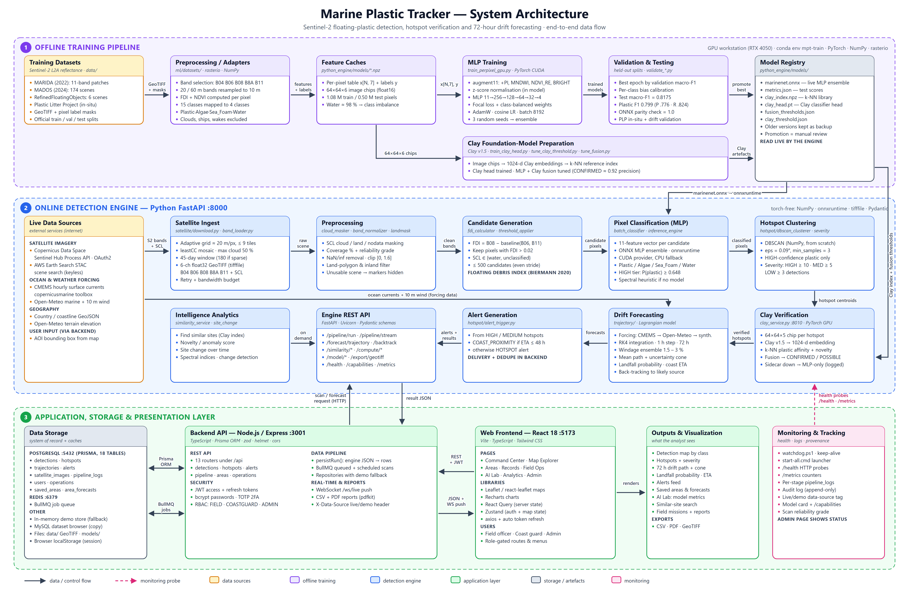

# Marine Plastic Tracker — System Architecture



*Files in this folder: `architecture.png` (5200 × 3400 px, for reports and slides), `architecture.svg` (vector, scales without blur), `generate_architecture.py` (rebuilds both).*

---

## Overall workflow in one paragraph

The system has three layers. **(1) Offline training** turns labelled Sentinel-2 research datasets into a trained pixel classifier (`marinenet.onnx`) and a Clay-based verifier, stored in the model registry. **(2) The online detection engine** downloads a fresh Sentinel-2 scene for the area a user selects, cleans it, finds floating-debris candidates with the FDI, classifies them with the trained MLP, clusters plastic into hotspots, verifies them with Clay, forecasts their 72-hour drift and raises alerts. **(3) The application layer** saves every result in PostgreSQL, enforces login and roles, pushes live updates, and shows maps, charts, alerts and reports in the React web app, while monitoring components track health and data provenance.

---

## Layer 1 — Offline training pipeline

Runs on a GPU workstation (RTX 4050) in the conda environment `mpt-train` using PyTorch, NumPy and rasterio. The model is trained here once and then reused; live scans never retrain it.

| Component | Purpose | Key details |
| --- | --- | --- |
| **Training datasets** | Labelled ground truth for learning | MARIDA (2022), MADOS (2024), RefinedFloatingObjects (2023), Plastic Litter Project (in-situ targets). Sentinel-2 L2A surface reflectance as GeoTIFF with pixel label masks and official train/val/test splits. Stored in `data/`. |
| **Preprocessing / adapters** (`ml/datasets/`) | Convert raw images into model-ready samples | **Band selection:** keeps B04, B06, B08, B8A, B11 from the 11–13 Sentinel-2 bands. **Resampling:** 20 m and 60 m bands brought onto the 10 m grid. **Feature computation:** FDI and NDVI per pixel. **Label mapping:** 15 research classes → 4 (Plastic, Algae, Sea_Foam, Water); clouds, ships and wakes excluded. |
| **Feature caches** (`models/*.npz`) | Save prepared data so images are read only once | Per-pixel table `x[N, 7]` + labels `y`; 64×64×6 chips for Clay. 1.08 M training and 0.50 M test pixels. Water is about 98 % of pixels, so classes are heavily imbalanced. |
| **MLP training** (`train_perpixel_gpu.py`) | Learn to classify a pixel from its spectrum | `augment11` adds 4 indices (PI, MNDWI, NDVI_RE, BRIGHT) → 11 features. **Normalisation:** z-score standardisation stored inside the model. Network 11→256→128→64→32→4. Focal loss + class-balanced weights against imbalance. AdamW, cosine learning rate, batch 8,192. Trained with 3 random seeds and averaged (ensemble). |
| **Validation & testing** | Choose and honestly score the model | Best epoch chosen by validation macro-F1; per-class bias calibration; held-out test **macro-F1 0.8175**, Plastic F1 0.799 (precision 0.776, recall 0.824); ONNX parity check 1.0; extra checks on PLP real plastic targets and drift tracks. |
| **Clay foundation-model preparation** | Build a second, independent verifier | Clay v1.5 turns image chips into 1,024-number embeddings, which form a k-NN reference library. A small Clay head is trained and MLP + Clay fusion thresholds are tuned, giving about 0.92 plastic precision at the CONFIRMED level. |
| **Model registry** (`python_engine/models/`) | Store the artefacts the live engine loads | `marinenet.onnx`, `metrics.json`, `clay_index.npz`, `clay_head.pt`, `fusion_thresholds.json`, `clay_threshold.json`. Older versions are kept; a new model is promoted only after manual review. |

---

## Layer 2 — Online detection engine

A Python FastAPI service on port 8000. It is deliberately torch-free (NumPy, onnxruntime, tifffile, Pydantic) so it stays light. Clay runs in a separate GPU process on port 8010.

| Component | Purpose | Key details |
| --- | --- | --- |
| **Live data sources** | External inputs | Copernicus Data Space (Sentinel Hub Process API, OAuth2) for imagery; AWS Earth Search STAC for scene search; CMEMS hourly currents (copernicusmarine) and Open-Meteo marine + 10 m wind for drift; coastline GeoJSON and Open-Meteo elevation for land checks; the user's area-of-interest box arrives through the backend. |
| **Satellite ingest** (`download.py`, `band_loader.py`) | Fetch the scene for the selected area | Adaptive ~20 m/pixel grid with up to 9 tiles; least-cloud mosaic with max 50 % cloud in a 45-day window (180 days if sparse); returns a 6-channel float32 GeoTIFF (B04, B06, B08, B8A, B11 + SCL) read with tifffile; retries and a bandwidth budget. |
| **Preprocessing** (`cloud_masker`, `band_normalizer`, `landmask`) | Make the scene safe and trustworthy | SCL-based cloud, land and no-data masking; coverage % and a reliability grade (reliable / degraded / unusable); NaN/inf removal and clipping to [0, 1.6]; land-polygon and inland-water filter; unusable scenes hide map markers. |
| **Candidate generation** (`fdi_calculator`, `threshold_applier`) | Find pixels that might be floating debris | Floating Debris Index (Biermann 2020): FDI = B08 − baseline(B06, B11). Keep pixels with FDI > 0.02 whose SCL class is water or unclassified; up to 500 candidates. |
| **Pixel classification** (`batch_classifier`, `inference_engine`) | Decide what each candidate is | Builds the same 11 features as training; runs the ONNX MLP ensemble with onnxruntime (CUDA if available, else CPU); outputs Plastic / Algae / Sea_Foam / Water + confidence; HIGH tier when P(plastic) ≥ 0.648 (about 90 % precision); spectral heuristic if no model loads. |
| **Hotspot clustering** (`dbscan_clusterer`, `severity_scorer`) | Group plastic pixels into actionable sites | DBSCAN written in NumPy, eps 0.09°, min_samples 3, using HIGH-confidence plastic only. Severity HIGH ≥ 10, MEDIUM ≥ 5, LOW ≥ 3 detections. |
| **Clay verification** (`clay_service.py`, `clay_live`, `confidence_fusion`) | Independent second opinion on each hotspot | 64×64×5 chip → Clay v1.5 1,024-d embedding → k-NN plastic affinity + novelty score → fused verdict CONFIRMED / POSSIBLE. If the sidecar is down, the scan continues MLP-only and logs it. |
| **Drift forecasting** (`trajectory/`) | Predict where the plastic will go | Forcing chosen in order CMEMS → Open-Meteo → synthetic; Lagrangian model with RK4 integration, 1-hour step, 72 hours; windage ensemble 1.5–3 %; mean path + uncertainty cone; landfall probability and coast ETA; back-tracking to a likely source. |
| **Alert generation** (`alert_trigger.py`) | Turn serious hotspots into warnings | HIGH/MEDIUM hotspots become alerts: COAST_PROXIMITY if ETA ≤ 48 h, otherwise HOTSPOT. Delivery and de-duplication happen in the backend. |
| **Intelligence analytics** (`similarity_service`, `site_change`) | Extra on-demand analysis | Find similar sites using the Clay index, novelty/anomaly score, a site's change over time, spectral indices and change detection. |
| **Engine REST API** (FastAPI, Uvicorn, Pydantic) | The engine's single entry point | `/pipeline/run`, `/pipeline/stream`, `/forecast/trajectory`, `/forecast/backtrack`, `/similarity/*`, `/compute/*`, `/model/*`, `/export/geotiff`, `/health`, `/capabilities`, `/metrics`. Returns one JSON result per scan. |

---

## Layer 3 — Application, storage and presentation

| Component | Purpose | Key details |
| --- | --- | --- |
| **Backend API** (Node.js 20, Express, TypeScript, port 3001) | Security, persistence and coordination | 13 REST routers under `/api`. JWT access + refresh tokens, bcrypt passwords, TOTP 2FA, role-based access (FIELD, COASTGUARD, ADMIN). zod validation, helmet, cors. `persistRun()` turns engine JSON into database rows. BullMQ for queued and scheduled scans. WebSocket `/ws/live` for push updates. CSV and PDF (pdfkit) reports. Falls back to demo data if the database is down. |
| **Data storage** | Keep results and jobs | **PostgreSQL** (via Prisma ORM, 18 tables: detections, hotspots, trajectories, alerts, satellite_images, pipeline_logs, users, operations, saved_areas, area_forecasts, …). **Redis** for the BullMQ job queue. In-memory demo store as fallback. MySQL dataset browser as an offline copy. GeoTIFF files in `data/` and model files in `models/`. |
| **Web frontend** (React 18, Vite, TypeScript, Tailwind, port 5173) | The analyst's interface | Pages: Command Center, Map Explorer, Areas, Records, Field Ops, AI Lab, Analytics, Admin. Leaflet maps, Recharts charts, React Query for server data, Zustand for login and map state, axios with automatic token refresh. Pages and menus are gated by role. |
| **Outputs & visualisation** | What the user sees and takes away | Detection map coloured by class, hotspots with severity, 72-hour drift path with uncertainty cone, landfall probability and ETA, live alert feed, saved areas and forecasts, model metrics in AI Lab, similar-site search, field missions and reports; exports as CSV, PDF and GeoTIFF. |
| **Monitoring & tracking** | Keep the system healthy and honest | `watchdog.ps1`, keep-alive and `start-all.cmd` manage the services; `/health` HTTP probes and `/metrics` counters; per-stage `pipeline_logs`; append-only `audit_logs`; a live/demo data-source tag on every response; model card and `/capabilities`; a reliability grade on every scan. The Admin page shows this status. |

---

## How the components communicate

| From → To | Protocol / mechanism | What travels |
| --- | --- | --- |
| Datasets → adapters → caches → training | Python file I/O (rasterio, NumPy) | GeoTIFF bands → feature tables (`.npz`) |
| Training → model registry | File export (ONNX, PyTorch, JSON) | Trained model, metrics, thresholds |
| Model registry → engine | Loaded at runtime by onnxruntime / NumPy | `marinenet.onnx`, Clay index, fusion thresholds |
| Browser → backend | HTTPS REST with a JWT bearer token | Scan, forecast and data requests |
| Backend → engine | HTTP (JSON) | Area box and run options → one result JSON |
| Engine → Copernicus / CMEMS / Open-Meteo | HTTPS (OAuth2 for Copernicus) | Satellite bands, currents, wind, elevation |
| Engine → Clay sidecar | HTTP on localhost (`/embed`) | Image chip → 1,024-d embedding |
| Backend → PostgreSQL | Prisma ORM (SQL) | Inserts and queries of all records |
| Backend → Redis | BullMQ | Background and scheduled scan jobs |
| Backend → browser | REST JSON + WebSocket `/ws/live` | Results and live alert/run events |
| Monitoring → services | HTTP health probes | `/health`, `/metrics` status |

---

## End-to-end flow (one scan)

1. The user draws an area on the map in the React frontend.
2. The frontend sends the area to the backend with the user's JWT; the backend checks the role.
3. The backend calls the engine's `/pipeline/run`.
4. The engine downloads the Sentinel-2 scene (5 bands + SCL) from Copernicus.
5. Preprocessing masks clouds and land, cleans values and grades reliability.
6. The FDI selects candidate debris pixels.
7. The ONNX MLP classifies each candidate into one of 4 classes with a confidence.
8. DBSCAN groups HIGH-confidence plastic into hotspots with severity.
9. The Clay sidecar verifies each hotspot (CONFIRMED / POSSIBLE).
10. The drift model forecasts 72-hour paths, uncertainty cones and landfall risk using CMEMS / Open-Meteo forcing.
11. Alerts are generated for serious hotspots.
12. The engine returns one JSON result; the backend stores it in PostgreSQL and pushes a live event.
13. The frontend refreshes the map, tables, alerts and charts; the user can export CSV, PDF or GeoTIFF.

---

## Regenerating the image

```powershell
cd docs\architecture
python generate_architecture.py
& "C:\Program Files\Google\Chrome\Application\chrome.exe" --headless=new --hide-scrollbars --force-device-scale-factor=2 --window-size=2600,1700 --screenshot="$PWD\architecture.png" "file:///$($PWD -replace '\\','/')/architecture.html"
```

Edit the text or numbers in `generate_architecture.py`, run it, then re-take the screenshot. Use the SVG when you need the sharpest possible print.
